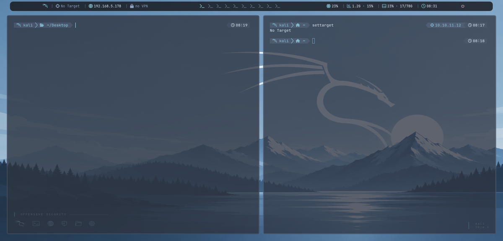
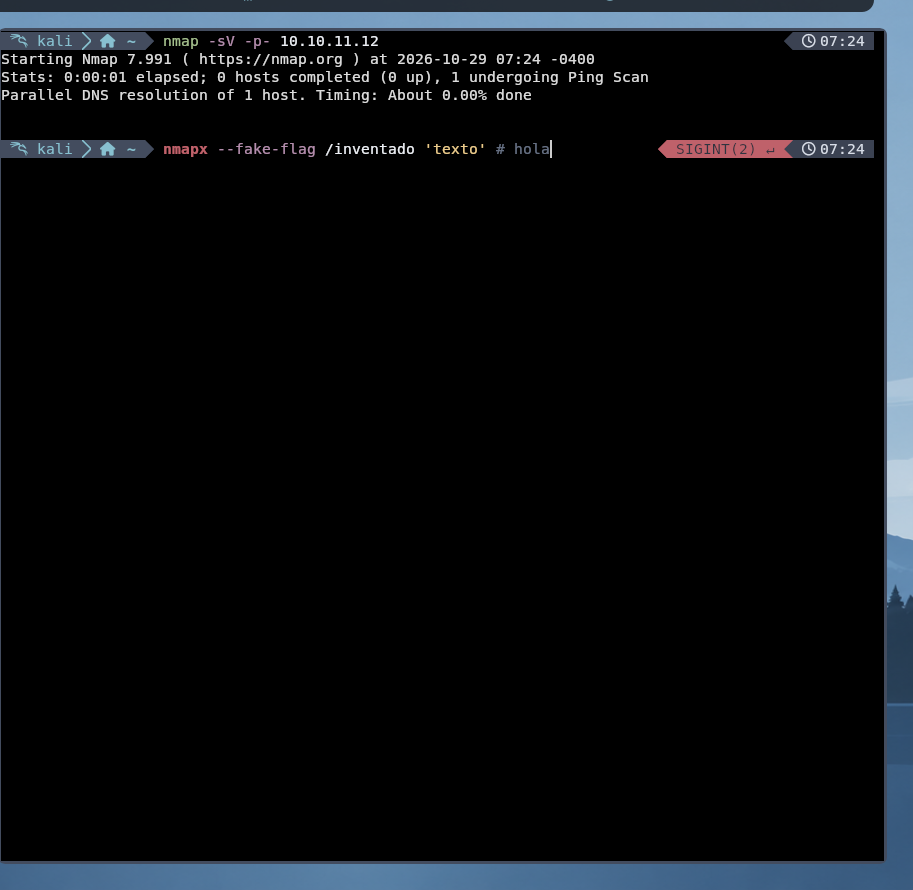
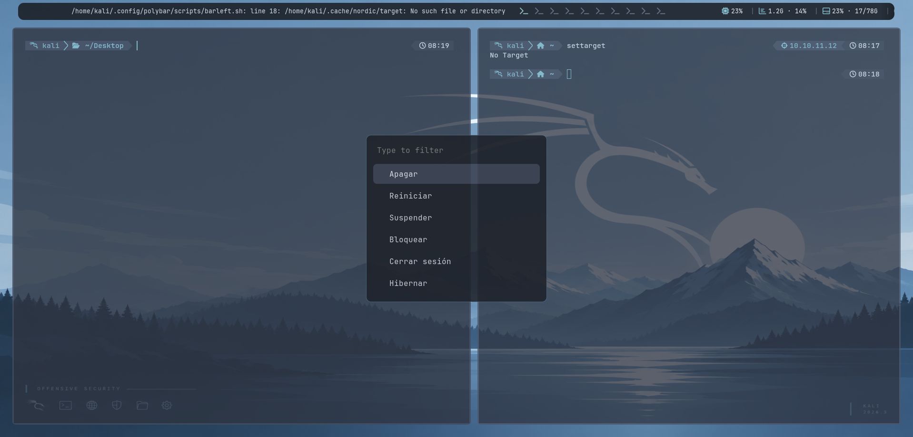
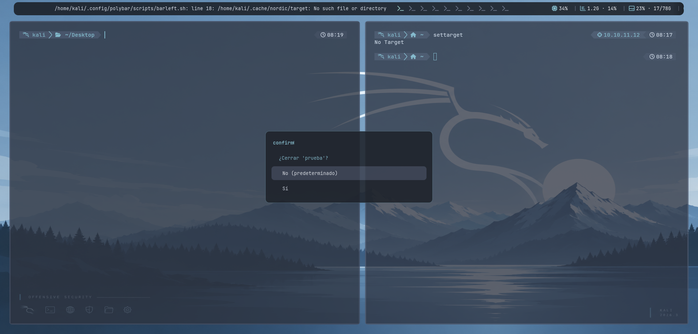

# 🐉 kali-nordic

> Entorno de escritorio **kali-nordic**: bspwm + polybar + picom + kitty + zsh con la paleta **Nord**, diseñado para pentesting y CTF. Un instalador autocontenido monta y valida el 100% del entorno.


**📖 Documentación extendida:** [https://d1se0.github.io/kali-nordic/](https://d1se0.github.io/kali-nordic/) (desplegada con GitHub Actions)

---

## 📸 Vista rápida

| Escritorio completo | Shell con colores en vivo |
| --- | --- |
|  |  |

| Menú de energía (rofi glass) | Confirmación segura |
| --- | --- |
|  |  |

*(Las capturas se generaron sobre la VM real del entorno.)*

---

## ✨ ¿Qué lo hace especial?

- 🎯 **Target inteligente** — `settarget <IP> [nombre]` y toda la barra, la shell (`$TARGET`) y el portapapeles se sincronizan al instante. Estado vacío = `No Target` en gris.
- ⌨️ **F1 / F2 escriben IPs** — F1 tu IP (prioriza la VPN de HTB si está activa), F2 la de la víctima, **exactamente donde esté el cursor** (widget zsh sobre las secuencias reales del terminal, incluye la variante NumLock de kitty).
- 🧞 **Autosugerencias fish-like** — el shell recuerda tu comando anterior con ese inicio y lo muestra como texto fantasma; `→` lo acepta y `↑` navega el historial por prefijo.
- 🌈 **Sintaxis coloreada mientras escribes** — comando existente **verde**, inexistente **rojo negrita**, opciones `-sV`/`--flag` **violeta**, rutas **cian**, strings **amarillo**, comentarios **gris**.
- 🪟 **Barra única con contexto** — dragón Kali, IP víctima, IP local, VPN (etiqueta `HTB` si es 10.10.x.x), escritorios, CPU/RAM/disco y reloj. Cada píldora responde al clic.
- 🔮 **Menús glass** — rofi 2.0 con temas intercambiables y modi scripts propios: menú de energía y confirmaciones Yes/No (No por defecto) incluso al cerrar ventanas.
- 🌙 **Lockscreen + greeter Nord** — login y pantalla de bloqueo con estilo compartido, y bloqueo automático al suspender (hook systemd).
- 📦 **Instalador autocontenido** — un solo `.sh` con todo el entorno embebido (payload + MD5 verificado), validaciones previas e idempotente.
- 🩺 **nordic-doctor** — auditoría de los 30+ componentes con detección de piezas ausentes o rotas.

<details>
<summary><b>🗂 Lista completa de componentes</b></summary>

| Capa | Componentes |
| --- | --- |
| Sesión | LightDM → sesión `bspwm`, `nordic-session`, teclado `es` en 4 capas (bspwmrc/xprofile/localectl/lightdm) |
| WM | bspwm (10 escritorios, reglas por app, balanceo automático), sxhkd (40+ atajos) |
| Shell | kitty + powerlevel10k Nord Frost, zsh con autosugerencias/sintaxis/F1-F2, aliases modernos (eza, bat) |
| Barra | polybar de una pieza: `barleft` (target/IP/VPN), workspaces con cola, `barright` (CPU/RAM/disco/reloj), power |
| Menús | rofi glass (6 temas) + modi scripts: power, confirm, target |
| Compositor | picom `glass`/`lite` automático según GPU, blur dual-kawase conmutables |
| Extras | nordic-lock + hook de suspensión, greeter Nord con fondo propio, nordic.nanorc, scratchpad, clipmenu, screenshot, doctor, cheatsheet, CTF helpers (`ctfinit`, `lis`, `extract`, `cheat`) |

</details>

---

## 🚀 Instalación

### Opción recomendada — release compilada
```bash
curl -O https://github.com/D1se0/kali-nordic/releases/latest/download/nordic-env-installer.sh
chmod +x nordic-env-installer.sh
./nordic-env-installer.sh
```

### Opción manual — clonar y correr
```bash
git clone https://github.com/D1se0/kali-nordic.git
cd kali-nordic
chmod +x install.sh && ./install.sh
```

1. El script valida sudo/paquetes/directorios, instala lo que falte, despliega configs y **verifica el resultado componente a componente**.
2. Cierra sesión y elige la sesión **"bspwm"** en el login Nord.

> ⚠️ Probado sobre **Kali Rolling x86_64** con LightDM. Idempotente: puedes relanzarlo sin romper nada. La cámara de tu configuración previa se respeta: no desinstala Xfce ni toca otros entornos.

---

## ⌨️ Atajos esenciales

| Atajo | Acción |
| --- | --- |
| `Super + Enter` | Abrir kitty |
| `Super + Espacio` | Rofi launcher |
| `Super + w` | Cerrar ventana (con confirmación) |
| `Super + Esc` | Menú de energía |
| `Super + Shift + L` | Lockscreen |
| `F1` / `F2` | Escribir tu IP / IP de la víctima |
| `Super + t` | Fijar target |
| `Super + 1…9, 0` | Ir al escritorio N |
| `Super + f` / `Super + m` | Fullscreen / monocle |
| `Super + BackSpace` | Scratchpad desplegable |
| `Super + F1` | Chuleta completa de atajos |

La lista completa vive en `config/sxhkd/sxhkdrc` y en la web.

---

## 🔧 Estructura del repo

```
kali-nordic/
├── bin/                  # scripts ejecutables del entorno (~20)
│   ├── settarget             # target compartido con la barra y la shell
│   ├── nordic-typeip         # F1/F2 escriben IPs en el cursor
│   ├── nordic-lock           # lockscreen con fondo Nord
│   ├── nordic-power/rofi/confirm/…
│   └── nordic-doctor         # auditoría del entorno
├── config/               # configs fuente (bspwm, sxhkd, polybar, kitty, rofi, picom, zsh, nano…)
├── install.sh            # instalador desde el árbol del repo
├── backups/
│   └── nordic-env-installer.sh   # ⭐ instalador AUTOCONTENIDO (payload embebido + md5)
├── docs/
│   ├── RELEASE.md            # release notes
│   └── screenshots/          # capturas usadas aquí y en la web
├── website/              # 🦋 web de documentación (React + Vite → GitHub Pages)
└── .github/workflows/    # deploy de Pages y release automática por tag
```

---

## 🦋 Desarrollo de la web

```bash
cd website
npm install
npm run dev          # http://localhost:5173
npm run build        # build de producción en website/dist
```

Sobre `main/master`, el workflow **deploy-pages.yml** compila y publica automáticamente en Pages. Requiere en Settings → Pages: *Source: "GitHub Actions"*.

## 🏷️ Releases

Al publicar una tag `v*`, el workflow **release.yml** crea la release con las notas de `docs/RELEASE.md` y adjunta el **instalador autocontenido** como asset.

---

## 📄 Licencia

GPL-3.0 — la paleta [Nord](https://www.nordtheme.com) pertenece a Arctic Ice Studio. Kali Linux es marca de Offensive Security.
